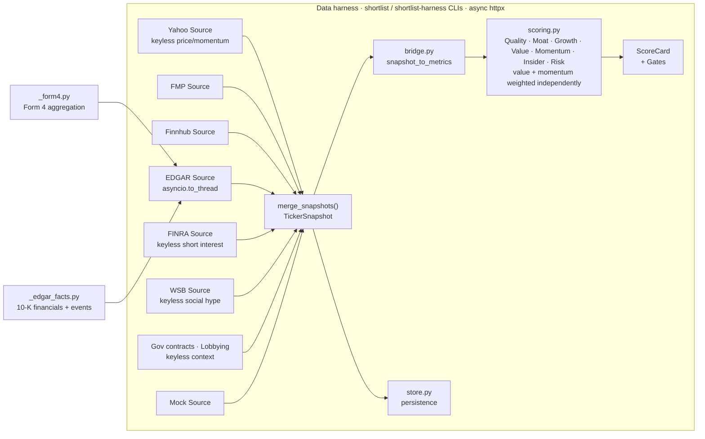

# Data harness (`shortlist.data`)

The collector layer: given tickers, every source fetches what it can, the collector merges it
into one **assessment-ready snapshot**, and the raw payloads are kept as a point-in-time
record. It deliberately knows nothing about scoring. Backtesting and point-in-time capture
live in `docs/BACKTEST.md`.

## Architecture



`bridge.py:snapshot_to_metrics` converts a `TickerSnapshot` into the `StockMetrics` that
`scoring.py` consumes. The keyless sources (Yahoo, FINRA, EDGAR) let `value`, `growth` and
`risk` be recovered when FMP gates a symbol, which it does for most non-mega-caps on the free
tier.

The only other `StockMetrics`-producing paths are the point-in-time XBRL backtest source and
the offline `MockProvider` fixture (`--demo` uses the harness `mock` Source).
`providers/_form4.py` and `providers/_edgar_facts.py` are imported by the harness
`EdgarSource` only; the backtest has its own extractor, `providers/_xbrl_facts.py`. The leaf
both share is `providers/_gaap_tags.py`. Fixing one extractor does not fix the other; see
`CLAUDE.md` → "Shared extraction leaves are edited once".

## Run

```bash
# Offline demo (no keys):
uv run shortlist-harness --tickers GEV,LMT,SCHW --sources mock --out snapshots

# Live (keys from the environment or a .env file):
uv run shortlist-harness --tickers GEV,LMT --sources fmp,finnhub --out snapshots --print
```

**Caching.** FMP and Finnhub responses are cached on disk (`.cache/http.sqlite`) by default,
so a warm re-run within TTL makes no upstream calls. `--no-cache` disables it for a run;
`--refresh-cache` repopulates. Yahoo and FINRA keep their own caches; EDGAR is uncached.
TTLs are in `config.yaml: cache.ttl`; design in `docs/DATA_SOURCES.md` §6.

Output per ticker is a coverage line:

```
GEV    coverage=  96% [ok] sources=mock -> snapshots/GEV/2026-05-31.json
SCHW   coverage=  82% [ok] sources=mock  missing: fundamentals.roic, fundamentals.gross_margin, ...
```

## What a snapshot contains

A `TickerSnapshot` (`data/models.py`) has six **key objects** (`profile`, `fundamentals`,
`statements`, `analyst`, `insider`, `price`), the only sections `coverage()` counts, and
**auxiliary sections** excluded from coverage because they are sparse by nature
(`_AUX_DEFAULTS`): `short_interest`, `events`, `social`, `gov_contracts`, `lobbying`, `news`
and `earnings`. A name with no 13D in the window must not read as thin data.

Every snapshot also carries `raw` (verbatim source payloads, for audit and replay),
`provenance` (which source supplied each object) and `errors` (per-section failures; one bad
endpoint never kills the run).

## How sources combine (`merge_snapshots`)

Each `Source` fetches and normalizes its own payloads; the collector merges by priority
(`yahoo > edgar > fmp > finnhub > mock`). Flat objects (`profile`, `fundamentals`, `analyst`,
`price`) merge **field by field**, so a gap in the primary source is filled from the next.
Yahoo leads so its keyless price/momentum wins the `price` merge and survives FMP gating.
`statements` takes the best single source (fiscal years are never interleaved). `insider` has
a bespoke merger: the coupled transaction facts (`net_value_6m`, `buy_count`, `sell_count`,
`recent`) come wholesale from the highest-priority source with trades, so the dollar figure
and counts describe the same trades, while `sentiment_mspr` is filled independently. Tickers
and sources run concurrently (`asyncio.gather`). Authority: `data/models.py`.

## EDGAR source

`EdgarSource` supplies three independent, failure-isolated sections (a missing XBRL filing,
e.g. a 20-F issuer or recent spin-off, degrades statements to `None` without affecting the rest):

1. **Form 4 insider trades**, aggregated by `providers/_form4.py`.
2. **10-K financial statements** via `get_financials()`: revenue, net income, operating cash
   flow, FCF, diluted EPS, and the leverage inputs (total debt, cash, operating income, D&A,
   interest expense). The bridge derives `ebitda`, `net_debt_to_ebitda` and an
   `interest_coverage` fallback (FMP keeps priority). These feed the `over_leveraged` gate,
   so the backfill matters most for FMP-gated large caps. edgartools exposes normalized
   `standard_concept` buckets, not raw us-gaap tags, and balance-sheet columns are instant
   dates; `tests/test_edgar_leverage_live.py` pins both.
3. **Filing-stream events** (`build_events_section`), built from one submissions-index read:
   8-K, `SC 13D`, `SC 13G`, Form 144 and the distress/dilution/accounting-integrity forms.
   They surface as advisory flags only (`scoring.py:_FILING_STREAM_FLAGS`). The section also
   carries `last_report_filed`, the latest exact-form 10-Q/10-K date and the bridge's SUE decay
   anchor (an amendment must never freshen it). Window and form list: `config.yaml:
   edgar_events`.

The source runs the synchronous edgartools work in a worker thread behind a shared semaphore
(`_EDGAR_MAX_CONCURRENCY`, default 3), because SEC fair-access is ~10 req/s per IP and the
per-ticker semaphore alone cannot hold a universe run under it. It needs the `[edgar]` extra
and `SEC_IDENTITY`; without either the source is skipped, not fatal.

### Bridge derivations when FMP is absent

When FMP has gated a symbol (402), `bridge.py` derives two value legs from free sources:
`fcf_yield` (latest-annual EDGAR FCF over market cap) and `pe_vs_history` (annual EDGAR EPS
against Yahoo's monthly-sampled historical closes). Both are approximate: history is ~3
fiscal years rather than 5, closes are not exact fiscal-year-end prices, and `pe_ttm` uses the
latest annual EPS as a TTM proxy. Both degrade to `None` without XBRL financials. PEG and
analyst-target upside still require FMP.

## Scoring a snapshot — the bridge

`data/bridge.py:snapshot_to_metrics()` flattens a `TickerSnapshot` into the `StockMetrics`
that `scoring.score()` consumes (`uv run shortlist --tickers GEV,AXON`). It derives fields the
snapshot does not store: `gross_margin_stability`, `fcf_positive`, and the growth legs
(`revenue_cagr`, `fcf_cagr`, `eps_cagr` as a net-income proxy, `revenue_growth_persistence`),
via the shared `shortlist.stats` helpers. It also surfaces Yahoo's `realized_vol` and
`max_drawdown` for the risk sub-score (displayed, composite weight 0.0; `docs/SCORING.md` →
The seven axes). From FMP annual history it maps `pe_median_5y` and `roic_5y_avg`.
`eps_revision` has no source and maps to `None`, so the scorer redistributes its weight. Cards
carry a `coverage` diagnostic built by `data/coverage_adapt.py` from provenance and errors.

**Sector detection.** The SIC comes only from EDGAR: `EdgarSource` emits a partial
`Profile(sic=…)` that survives FMP/Finnhub gating, the bridge copies it to `m.sic`, and
`score()` reads `m.sic`, never the free-text `Profile.sector`. This costs one extra SEC
request per ticker. See `docs/SCORING.md` → Sector-aware abstention.

## Auxiliary sources

- **FINRA short interest** (keyless) fills `short_interest` from one bulk fetch per run,
  cached by settlement date, so it adds no per-ticker load. The bridge derives
  `short_pct_outstanding`, `days_to_cover`, `short_interest_rising` and
  `short_data_age_days`; they feed only the `crowded_short` flag (`config.yaml:
  flags.crowded_short`).
- **Gov contracts** (USAspending) and **lobbying** (Senate LDA) are keyless, self-cached, and
  match the company by name with a confidence floor, abstaining rather than mis-attributing
  (`data/govcontract_match.py`, `data/entity_match.py`). Neither is scored: flat data and a
  research context line only. See `docs/DATA_SOURCES.md` §C2 and `docs/RESEARCH.md`.

`gates` are hard filters that flip `ScoreCard.passed`; `flags` are advisory and never change
`composite` or `passed`. The full lists are in `docs/SCORING.md` → Gates vs flags.

## Macro overlay (`data/macro.py`)

`fetch_macro(config)` builds a run-level `MacroContext` once per run from the official FRED
API (needs `FRED_API_KEY`; day-cached under `.cache/fred/`; never raises; returns `None` when
unkeyed). It is threaded into `run_harness(..., macro=)` and `build_report(..., macro=)`.
The report renders the regime (risk-on / risk-off / neutral) at the top, and the advisory
`risk_off_regime` flag fires on leveraged or cyclical names only in a risk-off regime
(`flags.risk_off_regime` and `macro:` in `config.yaml`). `--demo` skips the fetch, and the
flag is not XBRL-backtest-validatable.

## Adding a source

Subclass `Source`, implement `async def fetch(ticker) -> SourceResult` returning verbatim
`raw` plus a normalized `partial` `TickerSnapshot`, add the module under `data/sources/`, and
register it in `_REGISTRY` (`data/sources/__init__.py`), the authoritative list of wired
sources.

## Known limitations

- Dataclasses, not pydantic: bad payloads normalize to `None` rather than failing loud.
- The free-tier FMP daily quota, not per-call backoff, is the scale ceiling. A paid tier or a
  warm cache is the fix (`docs/DATA_SOURCES.md`).
- FMP's free plan gates many symbols per-symbol with a 402, so coverage correctly drops to
  "thin" for those names.
- Residual sector miscalibration (e.g. `net_margin` for banks) is tracked in
  `docs/SCORING.md` → Sector-aware abstention and `docs/ASSESSMENT_GAPS.md`.
- Mock data is illustrative, not verified.
