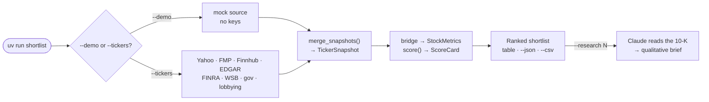

<div align="center">

# shortlist

**Hand it a ticker list. Get back a ranked shortlist worth your judgment.**

An open-source Python stock screener for fundamental analysis. It pulls data from SEC EDGAR,
Yahoo Finance, FMP and Finnhub, scores each stock on quality, moat, growth, value, momentum
and insider activity, and ranks the list — so your deep dive is spent on fewer, better names.

[](https://www.python.org/)
[](LICENSE)
[](https://github.com/christurgeon/shortlist/actions/workflows/ci.yml)
[](https://github.com/astral-sh/uv)

</div>

---

## Why shortlist

| | |
|---|---|
| **Multi-source by design** | Each data source supplies only the fields it is best at, merged by priority. |
| **Value-tilted** | Value and momentum are weighted separately, and value carries about 3× the weight. |
| **Sector-aware** | Banks, insurers and REITs skip the metrics that do not apply to them instead of getting a misleading number. |
| **Honest about gaps** | A missing score is shown as missing, never as zero, and every card says which source failed. |
| **Free-tier friendly** | Yahoo prices, SEC EDGAR financials and FINRA short interest need no key. `--demo` needs nothing at all. |
| **Evidence over opinion** | A new scoring input ships only if it predicts returns on two separate stock universes. Inputs that fail are switched off, and the verdict is kept in [`docs/audits/`](docs/audits/). |

## Quick start

Requires Python 3.11+ and [uv](https://github.com/astral-sh/uv).

```bash
git clone https://github.com/christurgeon/shortlist.git && cd shortlist
uv sync                          # install, pinned by uv.lock
uv run shortlist --demo          # offline sample basket, no keys needed
```

```
                                         Moat + value screen
┏━━━━━━┳━━━━━━━━┳━━━━━━━┳━━━━━━┳━━━━━━┳━━━━━━┳━━━━━━┳━━━━━━━┳━━━━━━━┳━━━━━━━┳━━━━━━━┳━━━━━━━━┳━━━━━━━┓
┃ Rank ┃ Ticker ┃ Score ┃ Qual ┃ Moat ┃ Grow ┃ Momt ┃ Value ┃ Insdr ┃  Conf ┃  Risk ┃ Upside ┃ Flags ┃
┡━━━━━━╇━━━━━━━━╇━━━━━━━╇━━━━━━╇━━━━━━╇━━━━━━╇━━━━━━╇━━━━━━━╇━━━━━━━╇━━━━━━━╇━━━━━━━╇━━━━━━━━╇━━━━━━━┩
│    1 │ GOOGL  │  65.3 │   95 │   87 │   65 │   54 │    42 │    42 │  1.00 │     - │    13% │ -     │
│    2 │ SCHW   │  63.4 │   64 │    - │   84 │    6 │    82 │    45 │  1.00 │     - │    32% │ -     │
│    3 │ GEV    │  57.5 │   85 │   45 │   78 │   78 │    44 │    27 │  1.00 │     - │    26% │ -     │
│    4 │ TMO    │  44.5 │   48 │   52 │   30 │   18 │    48 │    54 │  1.00 │     - │    22% │ -     │
│    5 │ LMT    │  40.2 │   46 │   52 │   32 │    2 │    40 │    50 │  1.00 │     - │    16% │ -     │
└──────┴────────┴───────┴──────┴──────┴──────┴──────┴───────┴───────┴───────┴───────┴────────┴───────┘
```

The dashes are intentional. SCHW has no moat score because it is a broker: the gross-margin
and ROIC inputs do not apply to it. `Risk` is blank for every row because the demo data has
no price history. A blank is never scored as zero, so it does not pull the composite down.

### Run it on real tickers

Copy the key template, fill in the keys you have, and pass your tickers:

```bash
cp .env.example .env             # .env is gitignored
uv sync --extra edgar            # adds the SEC EDGAR source
uv run shortlist --tickers GEV,LMT,SCHW,TMO,GOOGL --csv out.csv
```

| Source | Key | Supplies |
|---|---|---|
| Yahoo Finance | none | Prices, momentum, volatility, drawdown |
| SEC EDGAR | `SEC_IDENTITY` (your email) + `--extra edgar` | 10-K financials, Form 4 insider trades, filing events, sector (SIC) |
| FINRA | none | Short interest |
| [FMP](https://site.financialmodelingprep.com/) | `FMP_API_KEY` (free tier) | Ratios, analyst targets, PEG, 5-year history |
| [Finnhub](https://finnhub.io/) | `FINNHUB_API_KEY` (free tier) | Insider sentiment, analyst ratings, news, earnings |
| [FRED](https://fred.stlouisfed.org/) | `FRED_API_KEY` (free) | Macro regime overlay (optional) |

A missing key skips that source with a warning. A key exported in your shell overrides `.env`.

> **Do not pass `--provider` for a normal run.** It replaces the configured source list, so
> it silently drops the keyless sources such as Yahoo and FINRA.

## What it scores

Seven sub-scores, each 0–100. Each input is scaled over a band set in `config.yaml`. Six
sub-scores are weighted into the composite. `risk` is shown but not weighted.

| Sub-score | Default weight | Built from |
|---|---|---|
| **Quality** | 0.18 | ROE, net margin, interest coverage, leverage (inverted) |
| **Moat** | 0.18 | Gross-margin level and 5-year stability, persistent ROIC |
| **Growth** | 0.135 | Revenue / FCF / EPS CAGR, year-over-year growth persistence |
| **Value** | 0.22 | FCF yield, P/E vs its own 5-year median, upside to analyst target, PEG |
| **Momentum** | 0.08 | Price vs 200-day average, 6-month strength vs SPY, residual momentum |
| **Insider** | 0.135 | Net Form 4 buying/selling scaled by market cap, insider sentiment |
| **Risk** | 0.0 | Volatility and max drawdown, inverted — shown, not weighted ([why](docs/audits/2026-09-25-risk-tilt-disable.md)) |

**Gates** mark a name that fails a hard rule: negative free cash flow, market cap under
$300M, too much leverage, or heavy insider selling. A gated name stays in the table, shown in
red with the gate named, but it is not picked for `--research`. **Flags** such as
`crowded_short` or `value_trap` are notes only and never change a score.

All weights, bands and thresholds live in `config.yaml`. Tuning needs no code change.

→ **[docs/SCORING.md](docs/SCORING.md)** for the full method, every gate and flag, and sector handling.

## How it works



One async `httpx` data layer feeds one scorer. Yahoo and EDGAR need no key and take priority
in the merge, so value, growth, momentum and risk still score when FMP's free tier blocks a
symbol (it blocks most companies that are not mega-caps).

→ **[HARNESS.md](HARNESS.md)** for the data layer and snapshot format.

## Commands

| Command | Purpose |
|---|---|
| `shortlist` | Rank tickers (`--demo`, `--json`, `--csv`, `--research N`). Responses are cached on disk. |
| `shortlist-harness` | Fetch and save one raw data snapshot per ticker. |
| `shortlist-backtest` | Test scores against later returns: rank IC and quantile spreads. |
| `shortlist-accumulate` | Save a daily point-in-time snapshot so the backtest builds history. Not scheduled by default. |
| `shortlist-bot` | Telegram bot for screening from your phone. |

## Telegram bot

`shortlist-bot` long-polls Telegram, so it needs no webhook and no open port. It answers
only your own chat id.

```bash
uv sync --extra bot --extra edgar
uv run shortlist-bot
```

| | |
|---|---|
| `/screen nvda, lmt, msft` | Ranked dashboard in seconds |
| `/deep tsla` | The same, plus the Claude 10-K brief |
| `/portfolio` | Re-screens what you own: exposure, sector concentration, alerts |
| `/explain 13d` | What a term in these reports means |

→ **[docs/TELEGRAM.md](docs/TELEGRAM.md)** for setup and the full command list.

## Qualitative research

`--research N` gives the latest 10-K of the top N non-gated names to the local
[Claude Code](https://code.claude.com/docs) CLI. It writes a brief: moat,
material risks, red flags, capital allocation, and a bull/bear thesis with what would change
the view. Each factual finding carries a quote from the filing, and the tool checks that the
quote really appears there. The brief sits beside the score and never changes the ranking.

```bash
uv run shortlist --tickers GEV,LMT,GOOGL --research 3
```

→ **[docs/RESEARCH.md](docs/RESEARCH.md)** for what goes into a brief, caching and the kill switch.

## Claude Code skills

Two optional [Claude Code](https://code.claude.com/docs) skills ship in
`.claude/skills/`. They are not part of the Python package.

- **`/run`** — screen a list: run the CLI, then explain the scores, gates and data gaps.
- **`/prospect`** — web research that finds 5–8 new candidates to feed into the screener.
  The package itself has no market-wide scan; you bring the tickers.

## Docs

**How it works today**

| Doc | Contents |
|---|---|
| [docs/SCORING.md](docs/SCORING.md) | Sub-scores, weights, gates, flags, sector handling |
| [HARNESS.md](HARNESS.md) | The data layer, source merge and snapshot format |
| [docs/RESEARCH.md](docs/RESEARCH.md) | The Claude 10-K brief (`--research N`, `/deep`) |
| [docs/TELEGRAM.md](docs/TELEGRAM.md) | Bot setup, commands, holdings |
| [docs/BACKTEST.md](docs/BACKTEST.md) | Backtesting, weight fitting, snapshot capture |
| [docs/EDGAR_CLIENTS.md](docs/EDGAR_CLIENTS.md) | The standalone SEC EDGAR client library |
| [deploy/README.md](deploy/README.md) | systemd units for an always-on install |

**Background and evidence** — dated records of why decisions were made. They are not kept in
step with the code.

| Doc | Contents |
|---|---|
| [docs/audits/](docs/audits/README.md) | Every signal measured, shipped or killed, with the evidence |
| [docs/ASSESSMENT_GAPS.md](docs/ASSESSMENT_GAPS.md) | What is not validated yet, and the scoring roadmap |
| [docs/DATA_SOURCES.md](docs/DATA_SOURCES.md) | Data-source survey and roadmap |
| [docs/PREDICTIVE_SIGNALS_RESEARCH.md](docs/PREDICTIVE_SIGNALS_RESEARCH.md) | The literature review behind the candidate signals |
| [docs/design/](docs/design/) | Design notes written before a feature was built |
| [CLAUDE.md](CLAUDE.md) | Working rules for AI coding agents in this repo |

## Limitations

- **The weights are a starting assumption, not a fitted result.** Only some inputs are
  validated against later returns. See [docs/ASSESSMENT_GAPS.md](docs/ASSESSMENT_GAPS.md).
- **It is a triage tool, not a return-prediction model.** Validation runs on a few hundred
  currently-listed stocks on free data. At that size most factor effects cannot be told
  apart from noise, and the survivor bias makes results look better than they are.
- **Sector handling skips metrics; it does not re-tune them.** Treat composites that compare
  different sectors as rough.
- **`--demo` data is illustrative.** Some values are placeholders, not real figures.
- **It is not financial advice.** It narrows the list for a human deep dive.

## License

[AGPL-3.0-or-later](LICENSE) © Chris Turgeon. You may use, study and modify it. If you
distribute a modified version, or run one as a network service, you must publish its source
under the same license. This is a research tool and **not financial advice**: it makes no
recommendation to buy or sell any security.
